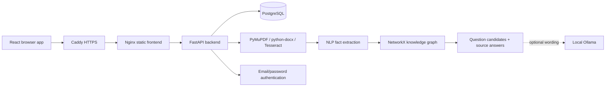

# Question Garden

An independent smart question generator for a DevOps project. Everything it needs lives in this folder; it does not use the parent Hackathon Management System's frontend, backend, dependencies, authentication, or database.

## What it does

- Generates multiple-choice, fill-in-the-blank, short-answer, and long-answer questions with answers and source evidence.
- Extracts English subject/relation/object facts, deduplicates them with NLP normalization, and constructs a directed knowledge graph with NetworkX. Long answers traverse related graph edges.
- Stops when supported facts are exhausted. Asking for 10 when only 7 eligible facts remain yields 7 and bills only 7. A fact already used in a session is not reused in another format. Long answers consume at least three related facts.
- Saves pasted text, original PDFs/DOCX files, extracted text, graphs, and question sets as private sessions.
- Reads native PDF text, Word paragraphs/tables/headers/footers, and uses Tesseract OCR for scanned PDF pages and supported embedded images.
- Provides email/password sign-up and sign-in, 100 free credits daily, 1 credit per text question, 2 credits per document question, and a clearly labeled simulated ₹100 → 1,000-credit purchase.
- Exports either questions only or questions with answers to PDF. Original sources can also be downloaded.
- Includes Docker Compose, PostgreSQL, HTTPS via Caddy, health checks, bounded logs, a backup script, and a CI workflow template.

## Run locally without Docker

Prerequisites: Python 3.12+ and Node.js 22.12+ (24 also works). Tesseract is needed for scanned documents and Word images; native text extraction works without it. Docker includes Tesseract automatically.

From `backend`:

```bash
python -m venv .venv
# Ubuntu/macOS:
source .venv/bin/activate
# Windows PowerShell instead:
# .venv\Scripts\Activate.ps1
python -m pip install -r requirements.lock
cp .env.example .env
python -m uvicorn app.main:app --host 127.0.0.1 --port 8000 --reload
```

On Windows PowerShell, use `Copy-Item .env.example .env` instead of `cp` if preferred. If script activation is restricted, call `.venv/Scripts/python.exe` directly. The backend example enables **local demo sign-in**, which uses a single shared demo account. Keep it bound to localhost; turn `ALLOW_DEMO_AUTH=false` before public deployment.

From `frontend`, in another terminal:

```bash
npm ci
npm run dev
```

Open <http://127.0.0.1:5173>. Create an email/password account, then paste source text or upload a document and generate questions. To test long answers independently, create a fresh session and select Long answer alone. SQLite is used only for local development. Interactive API docs: <http://127.0.0.1:8000/docs>.

Install OCR on Ubuntu with `sudo apt-get install tesseract-ocr tesseract-ocr-eng`. On Windows, install Tesseract separately and set `TESSERACT_CMD` in `backend/.env` to the executable path. OCR supports English in this version.

## Run locally with Docker

```bash
cp .env.example .env
# Set POSTGRES_PASSWORD to a random hexadecimal password.
# Set ALLOW_DEMO_AUTH=true for localhost testing only.
docker compose up -d --build
docker compose ps
```

Open <http://localhost>. The default port binding is loopback-only. Frontend and API share an origin, so there is no separate browser-facing API URL to configure. The database and API do not publish host ports.

**For a public Ubuntu VM, follow [DEPLOYMENT_UBUNTU.md](DEPLOYMENT_UBUNTU.md).** It covers a GCP Compute Engine VM as well as other Ubuntu VMs.

## Generation behavior and limits

This is a conservative **extractive NLP baseline**, not a general-purpose reasoning model. It supports English declarative subject–predicate–object patterns (for example “Photosynthesis produces glucose and oxygen”). It may extract fewer facts from prose with pronouns, unusual grammar, complex equations, tables without sentences, or poor OCR. A zero-result response means no eligible facts were found; it does not claim that a human could not write more questions.

MCQs need three distinct source-derived distractors with matching relation types. A long answer needs at least three unused facts about the same subject. Mixed-format generation uses a best-effort rotation; selected formats are not guaranteed in every set. No questions are padded to reach the requested count. Source assertions can themselves be incorrect or ambiguous, and OCR can introduce mistakes: review the evidence before using questions for assessment.

Optional Ollama rewrites question wording only. It cannot replace stored source evidence, answers, or options; a conservative similarity check rejects large rewrites. This is not semantic proof that wording is correct. Model failure falls back to extractive wording. The UI and API remain usable without any model download or paid AI API.

Defaults: 10 MB per upload, 30 PDF pages, 60,000 extracted text characters, 50 questions per generation. Word `.docx` is supported; legacy binary `.doc` must first be saved as `.docx`. Supported raster images in DOCX are OCR'd, but vector drawings, handwritten text, and mathematical layout are not interpreted reliably. Saved sources are immutable: create another session to use revised material.

## Credits and integrity

- Free allowance resets to **100 at midnight Asia/Kolkata**, lazily on the next account request. Unused free credits expire; they do not accumulate.
- Purchased demo credits persist and are spent after free credits.
- Generation, question persistence, ledger entry, and credit deduction commit in one transaction. PostgreSQL user-row locks serialize concurrent operations on an account; SQLite uses an immediate write transaction for local tests.
- A request UUID makes generation and demo-purchase retries idempotent. Reusing a UUID with different input is rejected. Retrying the same operation does not charge twice.
- Demo checkout collects no card data and performs no real payment. It can be disabled with `DEMO_PAYMENTS_ENABLED=false`.
- Email/password accounts use salted scrypt password hashes. Random seven-day bearer sessions are stored as hashes server-side; browser tokens live in session storage and are revoked on logout.
- Source, original-file, generation, deletion, and export endpoints check ownership. Session deletion removes its original file, extracted text, graph, questions, and cached generation results. Credit audit entries remain.

## Storage and deployment architecture



For this project, original documents are stored as binary data in PostgreSQL. One database backup therefore contains users, credits, original files, and sessions. This is simple for a small deployment with upload limits. At larger scale, move originals to a private object bucket and extraction/generation to a background job queue. OCR currently runs in bounded synchronous API work; multiple large OCR uploads can still consume CPU. Add managed PostgreSQL, schema migrations, distributed rate limiting, job queues, monitoring, and storage quotas before a larger public service. `create_all` creates the initial schema; it does not migrate an existing schema after changes.

## Tests and project layout

```bash
cd backend
python -m pytest -q
cd ../frontend
npm run build
```

The tests use a dedicated `test_question_generator.db`, recreate its tables, and never use the application's normal database. `TEST_DATABASE_URL` can point to an **isolated disposable test database** for PostgreSQL testing; never point it at production.

```text
question generator/
  frontend/                  React, Vite, Tailwind, nginx and frontend Dockerfile
  backend/
    app/config.py            Environment settings
    app/database.py          Models and transactions
    app/main.py              Authentication, sessions, credits and API
    app/generator.py          NLP, knowledge graph and question generation
    app/documents.py          Document extraction, OCR and PDF export
    tests/test_app.py         Functional and concurrency tests
  compose.yaml               Independent deployment stack
  deploy/Caddyfile            HTTPS reverse proxy
  deploy/backup.sh            Consistent PostgreSQL backup
  deploy/ci.yml.example       CI template for an independent repository
  DEPLOYMENT_UBUNTU.md        Deployment walkthrough
```

The Jenkinsfile is the primary CI entry point; see [Jenkins setup and evidence](docs/JENKINS.md). The GitHub Actions workflow remains an optional template. To activate it, put this folder's contents in their own Git repository and copy `deploy/ci.yml.example` to `.github/workflows/ci.yml`. It tests both SQLite and a disposable PostgreSQL service. Python dependencies are pinned in `backend/requirements.lock` (resolved for Python 3.12 across platforms), and frontend dependencies in `frontend/package-lock.json`. To intentionally update Python dependencies, run `uv pip compile requirements.txt --python-version 3.12 --universal --output-file requirements.lock` from `backend`, then install and test the new lock.

## Verification boundaries

Local automated tests cover extraction, all question formats, exhaustion, credit costs/resets, concurrency, account isolation, request idempotency, original download, and PDF exports. Browser smoke testing covers the local demo flow. Google OAuth is not used. Email verification and password recovery are not configured. Real Tesseract execution, optional Ollama inference, and the Linux container stack must be checked on the deployment host if those runtimes are absent locally. See the deployment guide's acceptance checklist.


## Jenkins pipeline

Use this repository with Jenkins Pipeline from SCM and script path `Jenkinsfile`. See [docs/JENKINS.md](docs/JENKINS.md) for prerequisites, stages, and evidence boundaries. The optional Docker stage builds images without publishing or deploying them.
